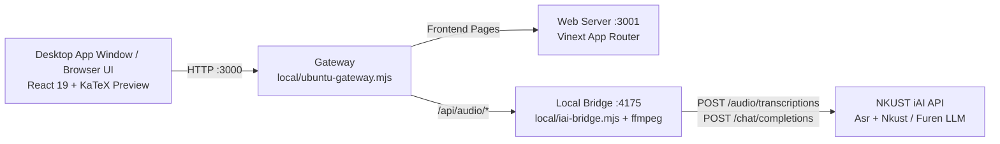

# NKUST iAI Note Tools｜Classroom Audio to Study Notes Tool

**Language / 語言**：[繁體中文](./README.md) | [English](./README.en.md)

---

## 🌱 Project Purpose

> **"When an instructor permits recording in class, students can use their lecture recordings with the university's AI models to organize a personalized, well-structured set of study notes."**

University lectures often deliver a large amount of information in a short time, making it difficult for students to both listen attentively and take verbatim notes. The **National Kaohsiung University of Science and Technology (NKUST) iAI Platform** provides speech recognition (`Asr`) and Large Language Models (`Nkust` and `Furen` series) for faculty and students. This open-source tool is built to help students make the most of those campus resources:

- **Respect Classroom Policies**: Always obtain explicit permission from your instructor before recording any lecture, and use the generated notes strictly for personal study and review.
- **Leverage Campus AI Resources**: Connects directly using your own NKUST iAI API Key—no external paid transcription service required.
- **Privacy First, Zero Data Retention**: All audio segmentation and file processing run locally on your own device. Your API Key is kept only in volatile runtime memory and is never written to databases, cookies, or recovery files.
- **Fully Open Source (MIT License)**: Free for students, educators, and developers to download, deploy, learn from, and extend.

---

## ✨ Full Feature Overview

1. **Automatic Large-Audio Segmentation & Transcoding (Bypass Upload & Timeout Limits)**
   - Supports `MP3`, `M4A`, and `WAV` files up to **30 MB** per file.
   - Uses built-in `ffmpeg-static` to automatically transcode long recordings into mono 16 kHz / 32 kbps MP3 segments (3 minutes each) and send them sequentially to NKUST iAI `Asr` (backed by `whisper`), preventing upstream `413 Request Entity Too Large` errors and reverse-proxy timeouts.
2. **ASR Repetition Loop & Boundary Overlap Cleanup**
   - Automatically detects and removes repetitive speech-recognition hallucination loops and duplicate sentences across segment boundaries.
3. **Traditional Chinese Transcript Correction (Preserving English Terminology)**
   - Corrects homophone typos, punctuation, and sentence boundaries using NKUST iAI LLMs and `opencc-js`, while preserving English technical terms, mathematical formulas, and code indentation.
4. **Multi-Stage AI Study Handout Pipeline (Filter → Write → Independent Review → Merge)**
   - **Stage A (Content Filter)**: Classifies each unit into `study` (academic knowledge & explicit exam/assignment reminders), `aside` (chitchat), or `noise`.
   - **Stage B (Handout Writer)**: Produces textbook-grade Markdown including a "Learning Overview", logically structured chapters (`##` / `###`), Markdown comparison tables, precise LaTeX derivations, step-by-step worked examples, and syntax-highlighted code blocks.
   - **Stage C (Independent Review & Local Repair)**: Verifies unit-by-unit coverage, checks explicit numeric arithmetic, validates KaTeX formula renderability, and performs **zero-token local JSON syntax repair** (automatically fixing missing colons, Chinese quotation marks, and trailing phantom commentary objects).
   - **Stage D (Smart Local Merge & Full Review)**: Combines all segments locally, removes duplicates, and generates a single unified "Full Review" section (`Key Concepts | Review Tips` table + sequentially numbered `Self-Check` questions).
5. **2-Way Controlled Concurrency & Checkpoint Resume (Zero Wasted API Quota)**
   - Processes up to 2 chunks concurrently to speed up long recordings and automatically bisects complex chunks into smaller units when retrying.
   - Supports browser local caching and **"Download Recovery File (No API Key)"**, allowing interrupted jobs (due to network drops or quota limits) to resume from the exact checkpoint without re-billing completed segments.
6. **Cross-Platform Native Desktop App (Windows / macOS / Linux)**
   - Packaged as an Electron desktop application that automatically launches the embedded `Bridge`, `Web Server`, and `Gateway` in the background—no terminal commands, Node.js, or FFmpeg installation required.
   - **First-Launch Shortcut Prompt**: Upon first launch after installation, a dialog asks **"Create a shortcut on your Desktop?"**—selecting **"Yes"** creates the shortcut on your Desktop; selecting **"No"** creates it inside your installation folder (supporting Windows `.lnk`, macOS `.app` symlink, and Linux `.desktop` launcher).

---

## 🤖 Supported NKUST iAI Models & Pricing

For the complete official verification table, see [MODEL_VERIFICATION.md](./MODEL_VERIFICATION.md) (pricing unit: per 1M tokens):

| Model Alias | Underlying Model | Category | Prompt Pricing | Completion Pricing | Recommended Use |
| --- | --- | --- | ---: | ---: | --- |
| `Asr` | `whisper` | Speech Processing (ASR & TTS) | 1/1M | 1/1M | Segmented lecture audio transcription |
| `Nkust` | `Nkust` | Large Language Model (LLM) | 0.09/1M | 0.34/1M | NKUST campus-native language model |
| `Furen-omni` | `nemotron-omni-30b` | Large Language Model (LLM) | 0.1/1M | 0.2/1M | Multimodal & general note organization |
| `Furen-std` | `nemotron-3-super-120b` | Large Language Model (LLM) | 0.15/1M | 0.3/1M | Balanced & reliable study notes (Default) |
| `Furen-coder` | `nemotron-3-super-120b` | Large Language Model (LLM) | 0.2/1M | 0.4/1M | Programming & technical courses |
| `Furen-large` | `nemotron-3-super-120b` | Large Language Model (LLM) | 0.2/1M | 0.4/1M | Long lectures & complex context |
| `Furen-max` | `nvidia-nemotron-3-ultra-550b-a55b` | Large Language Model (LLM) | 0.5/1M | 1/1M | Highest-tier organization & reasoning |

---

## 🏗️ System Architecture & How It Works



| Core Module | Responsibility |
| --- | --- |
| `electron/main.mjs` | Electron main process: orchestrates all three local services, dynamic port allocation, cross-platform `ffmpeg` path resolution, and the first-launch shortcut prompt |
| `local/iai-bridge.mjs` | Local FFmpeg audio segmentation, iAI API proxy, NDJSON progress streaming, heartbeat keep-alive, and concurrent request deduplication |
| `local/ubuntu-gateway.mjs` | Unified reverse proxy, same-origin enforcement, CSP security headers, and payload size guards |
| `lib/iai-workflow.ts` | File validation, ASR loop cleanup, transcript splitting, thinking/meta-rule filtering, KaTeX validation, and Markdown export |
| `lib/generic-content.ts` | Semantic unit splitting, filter/receipt parsing, local malformed JSON syntax pre-repair (missing colons / trailing noise), and numeric arithmetic verification |
| `lib/generic-study.ts` | Multi-stage study notes orchestrator, 2-way concurrency pool, automatic bisection, retry budget control, and checkpoint resume |
| `lib/generic-reader.ts` | Local smart chapter merger, unified "Learning Overview", and "Full Review" section builder |

---

## 📜 Changelog & Version Control

This project uses **Semantic Versioning (`vMAJOR.MINOR.PATCH`)**. Pushing a release Git Tag (`v*`) automatically triggers GitHub Actions (`.github/workflows/release-desktop.yml`) to run all **111 automated tests** and build native desktop packages for **Windows, macOS, and Linux**, publishing them directly to [GitHub Releases](https://github.com/WangBens/NKUST_iAI_Note-tools/releases).

| Version | Release Date | Highlights & Version Controls |
| --- | --- | --- |
| **`v1.0.2`** | 2026-11-21 | • **Updated Official Models & Pricing**: Added `Nkust` and `Furen-coder`, and synced underlying model mappings for `Asr` (`whisper`), `Furen-std` (`nemotron-3-super-120b`), and `Furen-max` (`nvidia-nemotron-3-ultra-550b-a55b`).<br>• **Official 3-Platform Desktop App Releases**: Fixed Linux `.deb` maintainer metadata and published Windows, macOS, and Linux installers simultaneously to GitHub Releases.<br>• **Dedicated Bilingual Docs**: Provided synchronized Traditional Chinese (`README.md`) and English (`README.en.md`) documentation. |
| **`v1.0.1`** | 2026-11-21 | • **First-Launch Shortcut Prompt**: Prompts users on first launch to create a shortcut on the Desktop (`Yes`) or in the installation folder (`No`), supporting Windows `.lnk`, macOS `.app`, and Linux `.desktop`.<br>• **Enhanced Local JSON Repair**: Automatically repairs missing colons (e.g., `"body"> ...`), misquoted fields, Chinese closing quotes, and trailing phantom commentary objects locally at zero token cost, and expands bisection retry budgets. |
| **`v1.0.0`** | 2026-11-21 | • **Desktop App Packaging**: Integrated Electron with ASAR packaging and unpacked `ffmpeg-static` for one-click GUI launch without terminal commands or Node.js.<br>• **Open-Source Release**: Removed all environment-specific paths/secrets and added the MIT License and full documentation. |
| **`v0.9.x`** | 2026-11-19 | • **Multi-Stage Verified Pipeline & 2-Way Concurrency**: Introduced Filter → Write → Independent Review → Local Merge, key-free recovery checkpoints, strict KaTeX validation, and arithmetic verification. |
| **`v0.5.x`** | 2026-09-25 | • **Three-Tier Architecture & Timeout Keep-Alive**: Built `Gateway + Web + Bridge` with NDJSON streaming, heartbeat keep-alive (preventing Cloudflare 524), and concurrent request deduplication. |

---

## 💻 Download & Installation

### Option 1: Download Cross-Platform Desktop App (Recommended for General Users)

Visit [**GitHub Releases**](https://github.com/WangBens/NKUST_iAI_Note-tools/releases) and download the latest package for your operating system:

- **Windows (64-bit)**: `NKUST iAI Note Tools Setup x.x.x.exe` (Standard Installer) or `NKUST iAI Note Tools-x.x.x-win.zip` (Portable)
- **macOS (Apple Silicon `arm64` / Intel `x64`)**: `NKUST iAI Note Tools-x.x.x-arm64.dmg` / `x64.dmg` (or `.zip`)
- **Linux (Ubuntu / Debian / Universal)**: `NKUST iAI Note Tools-x.x.x.AppImage` (Portable executable) or `.deb` (Debian / Ubuntu package)

> **💡 First-Launch Tip**: When you launch the installed app for the first time, a dialog will ask **"Create a shortcut on your Desktop?"**—select **"Yes"** to place it on your Desktop, or **"No"** to place it in your installation folder.

### Option 2: Run & Package from Source (Developers)

Requirements: **Node.js `>= 22.13.0`**, `pnpm` (enabled via `corepack enable`)

```bash
# 1. Clone repository and install dependencies
git clone https://github.com/WangBens/NKUST_iAI_Note-tools.git
cd NKUST_iAI_Note-tools
corepack enable
pnpm install

# 2. Launch Desktop App (builds frontend and opens native window)
pnpm run electron:dev

# 3. Or run in Web Dev Mode (requires two terminals)
pnpm run bridge   # Terminal 1: Audio & LLM Bridge (:4175)
pnpm run dev      # Terminal 2: Frontend Web UI (:3000)

# 4. Run all 111 automated tests (offline mock server, zero API quota used)
pnpm run test
```

### Offline Mock Mode (Zero iAI Quota Consumed)

```bash
# Terminal 1: Start local mock iAI server (127.0.0.1:4174)
pnpm run mock

# Terminal 2: Start dev server
pnpm run dev
```

Open `http://localhost:3000/?testMode=1` and enter `test-valid-key` to experience the full 6-step workflow offline.

### Option 3: Mobile & Tablet Access (iOS / Android)

The web UI supports responsive layouts (RWD). Run the service on your computer or Ubuntu server (via LAN, Tailscale, or Cloudflare Tunnel), open the URL in your mobile browser, and tap **"Add to Home Screen"** for a full-screen app-like experience.

---

## 📄 License

This project is released under the [MIT License](./LICENSE). Anyone is free to use, modify, and distribute it.
