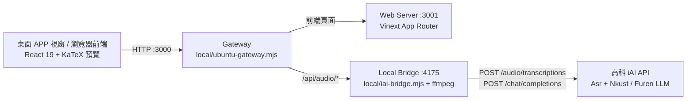

# NKUST iAI Note Tools｜知音筆記（高科 iAI 課堂錄音轉學習講義工具）

**語言 / Language**：[繁體中文](./README.md) | [English](./README.en.md)

---

## 🌱 專案初衷

> **「如果老師上課允許錄音，學生就可以利用錄音串接學校提供的 AI 模型，整理成一份屬於自己的學習重點。」**

在大學課程中，課堂資訊量往往非常龐大，學生很難在「專心聽講理解」與「逐字抄寫筆記」之間兼顧。**國立高雄科技大學（NKUST）iAI 平台**已為全校師生提供語音辨識（`Asr`）與大型語言模型（`Nkust` 與 `Furen` 系列），本專案便是為此打造的開源學習輔助工具：

- **尊重教學規範**：請務必在授課教師明確允許錄音的前提下使用，並僅供個人課後學習與複習用途。
- **善用校內資源**：直接串接學生本人的高科 iAI API Key，無須額外付費購買外部商業轉錄服務。
- **隱私優先、零個資留存**：所有音訊切段與檔案處理皆在使用者本機端完成；API Key 僅暫存於執行期記憶體，絕不寫入資料庫、Cookie 或復原檔。
- **MIT 完全開源**：歡迎全校同學、老師與開發者自由下載、部署、學習與二次開發。

---

## ✨ 完整功能介紹

1. **大檔音訊自動分段轉碼（突破上傳與逾時限制）**
   - 支援 `MP3` / `M4A` / `WAV`，單檔最高 **100 MB**。
   - 內建 `ffmpeg-static` 自動將長錄音轉碼為單聲道 16 kHz / 32 kbps MP3（每 3 分鐘一段）再逐段送往高科 iAI `Asr`（底層 `whisper`），避免觸發上游 `413 Request Entity Too Large` 或反向代理逾時。
2. **ASR 退化迴圈與邊界重疊清洗**
   - 自動偵測並移除語音辨識常見的連續跳針重複字詞與切段交界處的重複句子。
3. **繁體中文逐字稿校正（保留英文專有名詞）**
   - 透過高科 iAI 語言模型與 `opencc-js` 統一校正同音錯字、標點與斷句，同時完整保留英文技術術語、數學公式與程式碼縮排。
4. **整份逐字稿單次直出＋程式級「零腦補」五段式講義引擎（`v1.1.0` 全新升級）**
   - **單次整篇直出（Single-Shot Direct Markdown）**：善用高科 iAI `128K～1M` 長上下文視窗，60,000 字元以內直接以 **1 次請求**讀完完整逐字稿並產出唯一一份連貫的繁體中文 Markdown 講義，徹底告別分段拼湊與 JSON 跳脫破裂；超長錄音（> 60,000 字元）則自動切分大段並於最後執行 1 次統整。
   - **雙層強制關閉思考模式（`enable_thinking: false`）**：前端與本機橋接器雙層鎖定關閉思考推論（實測 `reasoning_tokens = 0`）並設為低發散溫度 `0.1`，大幅加快回應速度並防止過度腦補。
   - **程式級來源錨定防腦補（`enforceSourceGrounding`）**：自動解析逐字稿中的所有阿拉伯／中文口語數字與十六進位位址，凡未出現在錄音中的外部硬體規格數值、外部架構、虛構實體與語音錯字評論皆由程式自動過濾，並同步進行 KaTeX 公式驗證與 Token 退化亂碼攔截。
   - **五段式實戰講義結構**：統一產出「這堂課在講什麼（含建議閱讀順序、核心主軸）」、「核心專有名詞對照表／符號與單位」、明顯分段條列之分章正文教學、「總整理表」、「常見失分點與迷思」、「老師可能會考的考題」與「考前自我檢查」。
5. **快取續跑與零額度浪費機制**
   - 支援瀏覽器本地暫存與 **「下載復原檔（不含 API Key）」**，若中途網路中斷或額度用盡，可匯入復原檔直接載入已完成筆記或從斷點續跑，絕不重花任何 Token；並完整相容舊版多階段復原檔零 Token 匯出。
6. **跨平台原生桌面版 APP（Windows / macOS / Linux）**
   - 封裝為 Electron 桌面應用程式，點擊即自動於背景啟動內建 `Bridge`、`Web Server` 與 `Gateway`，免開終端機、免安裝 Node.js 與 FFmpeg。
   - **首次啟動捷徑精靈**：安裝並首次啟動 APP 後，會主動跳出視窗詢問 **「是否要在桌面建立捷徑？」**——選 **「是」** 自動建立於使用者桌面；選 **「否」** 則自動建立於使用者安裝程式的資料夾中（完整支援 Windows `.lnk`、macOS `.app` 符號連結與 Linux `.desktop` 啟動器）。
   - **自動檢查更新 & 左上角一鍵更新（`v1.2.0` 新增）**：每次開啟桌面版 APP 自動向 GitHub Releases 檢查是否有新版本；若有新版，左上角「知音筆記」旁將顯示 **「更新至 vX.X.X」** 按鈕，點擊即可即時顯示下載進度並自動啟動新版安裝更新（不影響網頁版介面）。

---

## 🤖 支援之高科 iAI 模型與計費標準

詳細核對資料請參閱 [MODEL_VERIFICATION.md](./MODEL_VERIFICATION.md)（計費單位為每 1M tokens）：

| 模型別名 | 實際模型 | 類型 | 輸入計費 (Prompt) | 輸出計費 (Completion) | 用途說明 |
| --- | --- | --- | ---: | ---: | --- |
| `Asr` | `whisper` | 語音處理 (ASR & TTS) | 1/1M | 1/1M | 課堂錄音分段語音轉錄 |
| `Nkust` | `Nkust` | 大型語言模型 (LLM) | 0.09/1M | 0.34/1M | 高科校內專屬語言模型 |
| `Furen-omni` | `nemotron-omni-30b` | 大型語言模型 (LLM) | 0.1/1M | 0.2/1M | 多模態與一般文字整理 |
| `Furen-std` | `nemotron-3-super-120b` | 大型語言模型 (LLM) | 0.15/1M | 0.3/1M | 穩定、均衡的文字整理（預設推薦） |
| `Furen-coder` | `nemotron-3-super-120b` | 大型語言模型 (LLM) | 0.2/1M | 0.4/1M | 程式設計與技術課程整理 |
| `Furen-large` | `nemotron-3-super-120b` | 大型語言模型 (LLM) | 0.2/1M | 0.4/1M | 長篇內容與複雜脈絡整理 |
| `Furen-max` | `nvidia-nemotron-3-ultra-550b-a55b` | 大型語言模型 (LLM) | 0.5/1M | 1/1M | 最高階整理與深度推理 |

---

## 🏗️ 系統架構與運作原理



| 核心模組 | 職責說明 |
| --- | --- |
| `electron/main.mjs` | Electron 桌面主程序：整合三層本機服務、動態埠位分配、跨平台 `ffmpeg` 路徑解析與首次啟動捷徑精靈 |
| `local/iai-bridge.mjs` | 本機音訊切段轉碼、iAI API 代理、NDJSON 進度串流、心跳保活與並發去重快取 |
| `local/ubuntu-gateway.mjs` | 統一入口反向代理、同源檢查、CSP 安全標頭與請求大小保護 |
| `lib/iai-workflow.ts` | 檔案驗證、ASR 退化清洗、分段切分、`enforceSourceGrounding` 程式級防腦補引擎、KaTeX 驗證與 Markdown 匯出 |
| `lib/direct-study.ts` | 整份逐字稿單次直出引擎（60,000 字元內 1 次呼叫、關閉思考模式、純淨 Markdown 直出與大段降級統整） |
| `lib/generic-content.ts` | 語意單位切分、篩選／回執解析、本地 JSON 語法預修復與數值算式驗算 |
| `lib/generic-study.ts` | 復原檔相容介面、續跑快取驗證與多階段管線核心 |
| `lib/generic-reader.ts` | 本地五段式講義結構組裝、H3 自動拆章、表格／清單規範化與缺失複習區自動補齊 |

---

## 📜 版本更新紀錄與版本控制

本專案採用 **語意化版本控制（Semantic Versioning，`vMAJOR.MINOR.PATCH`）**。每當推送正式版 Git Tag（`v*`）時，GitHub Actions（`.github/workflows/release-desktop.yml`）會自動執行全部 **119 項自動化測試**，並同步編譯打包 **Windows、macOS、Linux** 三大作業系統的桌面安裝包發布至 [GitHub Releases](https://github.com/WangBens/NKUST_iAI_Note-tools/releases)。

| 版本號 | 發布日期 | 更新重點與版本控制項目 |
| --- | --- | --- |
| **`v1.3.0`** | 2026-11-24 | • **新增 Android 手機版 APK**：GitHub Releases 同步建置並發布 `android.apk`，支援手機選取錄音檔與直接下載 `.md` 筆記至手機下載資料夾。<br>• **「檢查更新」按鈕＋更新內容確認彈窗**：桌面版左上角常駐「檢查更新」按鈕（並支援背景自動搜尋），點擊後彈出視窗顯示最新版本更新內容，待使用者按「確認並開始更新」後才開始下載安裝。<br>• **介面視覺優化 & LaTeX 根治修復**：主畫面底部加入開源專案網址、隱藏右側多餘捲軸；修復 LaTeX 排版防崩潰並將規則與逐字稿以 `<system_rules>` / `<lecture_transcript>` 嚴格隔離（120 項測試全數通過）。 |
| **`v1.2.0`** | 2026-11-24 | • **桌面版自動檢查與左上角一鍵自動更新**：新增 `electron/preload.cjs` 與 `electron/updater-utils.mjs`，開啟桌面版 APP 自動查詢 GitHub Releases 最新版本；若有新版本即於左上角顯示更新按鈕，點擊即時顯示下載百分比並依作業系統自動啟動新版安裝（網頁版維持原貌不更動）。<br>• **新增自動更新單元測試**：全專案擴充至 **119 項自動化測試**。 |
| **`v1.1.0`** | 2026-11-23 | • **整份逐字稿單次直出模式（`lib/direct-study.ts`）**：60,000 字元內直接單次呼叫輸出唯一一份連貫的五段式 Markdown 講義，徹底解決過去分段拼湊重複與 JSON 跳脫破裂問題，速度提升 10 倍並大幅節省 Token。<br>• **雙層強制關閉思考模式**：前端與橋接器同步鎖定 `enable_thinking: false`（實測 `reasoning_tokens = 0`）與 `temperature: 0.1`。<br>• **跨學科程式級防腦補引擎（`enforceSourceGrounding`）**：自動比對逐字稿真實數字／位址，攔截無來源規格數據、外部架構、虛構實體與 Token 退化亂碼。<br>• **實機六大領域與六款 LLM 盲測驗證**：確認 `Furen-std` 為全科首選，單檔上限提升至 **100 MB**，全專案通過 **117 項自動化測試**。 |
| **`v1.0.2`** | 2026-11-21 | • **同步官方最新模型清單與計費標準**：新增 `Nkust` 與 `Furen-coder`，並將 `Asr`（`whisper`）、`Furen-std`（`nemotron-3-super-120b`）、`Furen-max`（`nvidia-nemotron-3-ultra-550b-a55b`）等實際底層對應全面更新至最新公告。<br>• **正式發布三平台桌面版 APP**：修復 Linux `.deb` 封裝維護者設定，同步於 GitHub Releases 發布 Windows、macOS、Linux 三大平台安裝包。<br>• **獨立雙語文件**：提供內容完全對等之繁體中文（`README.md`）與英文（`README.en.md`）雙語說明文件。 |
| **`v1.0.1`** | 2026-11-21 | • **首次啟動捷徑精靈**：安裝後首次啟動彈窗詢問是否於桌面建立捷徑（選「是」建於桌面、選「否」建於安裝資料夾），支援 Win `.lnk` / macOS `.app` / Linux `.desktop`。<br>• **JSON 容錯大升級**：新增本地語法修復，自動修補模型漏寫冒號（如 `"body"> ...`）、誤用中文引號與尾端空白註解物件，0 Token 救援失敗回覆並放寬二分切分重試配額。 |
| **`v1.0.0`** | 2026-11-21 | • **桌面版 APP 正式封裝**：整合 Electron + ASAR 封裝與內建 `ffmpeg-static` 解包，實現免終端機、免裝 Node.js 一鍵啟動桌面圖形介面。<br>• **開源化與隱私清理**：移除所有環境特定路徑與內部設定，加入 MIT License 與完整開源指南。 |
| **`v0.9.x`** | 2026-11-19 | • **多階段校核與 2 路並發管線**：導入「篩選 → 撰寫 → 獨立校核 → 本地合併」架構，支援斷點續跑復原檔（不含 API Key）、LaTeX KaTeX 嚴格驗算與數值運算一致性檢查。 |
| **`v0.5.x`** | 2026-09-25 | • **三層服務架構與防逾時保活**：建立 `Gateway + Web + Bridge` 架構，加入 NDJSON 串流進度、心跳保活（避免 Cloudflare 524）與並發請求去重。 |

---

## 💻 下載與安裝教學

### 方式一：直接下載跨平台桌面版 APP（推薦一般使用者）

前往 [**GitHub Releases**](https://github.com/WangBens/NKUST_iAI_Note-tools/releases) 下載對應作業系統的最新版本：

- **Windows（64-bit）**：`NKUST iAI Note Tools Setup x.x.x.exe`（標準安裝程式）或 `NKUST iAI Note Tools-x.x.x-win.zip`（免安裝綠色版）
- **macOS（Apple Silicon `arm64` / Intel `x64`）**：`NKUST iAI Note Tools-x.x.x-arm64.dmg` / `x64.dmg`（或 `.zip`）
- **Linux（Ubuntu / Debian / 通用）**：`NKUST iAI Note Tools-x.x.x.AppImage`（免安裝可執行檔）或 `.deb`（Debian / Ubuntu 安裝包）
- **Android 手機**：`NKUST-iAI-Note-Tools-x.x.x-android.apk`（下載後直接安裝使用）

> **💡 首次開啟提示**：安裝並首次啟動 APP 後，程式會跳出視窗詢問 **「是否要在桌面建立捷徑？」**，點選 **「是」** 會新增於桌面，點選 **「否」** 則會新增於您安裝程式的資料夾中。

### 方式二：開發者本機執行與自行打包

需求環境：**Node.js `>= 22.13.0`**、`pnpm`（透過 `corepack enable` 啟用）

```bash
# 1. 下載專案並安裝相依套件
git clone https://github.com/WangBens/NKUST_iAI_Note-tools.git
cd NKUST_iAI_Note-tools
corepack enable
pnpm install

# 2. 啟動桌面版 APP（自動建置並開啟原生視窗）
pnpm run electron:dev

# 3. 或以網頁開發模式啟動（需開兩個終端機）
pnpm run bridge   # 終端機 1：音訊與 LLM 橋接器 (:4175)
pnpm run dev      # 終端機 2：前端 Web 介面 (:3000)

# 4. 執行全部 111 項自動化測試（使用離線模擬伺服器，不消耗 iAI 額度）
pnpm run test
```

### 離線模擬測試模式（不消耗 iAI 額度）

```bash
# 終端機 1：啟動本地模擬 iAI 伺服器 (127.0.0.1:4174)
pnpm run mock

# 終端機 2：啟動開發伺服器
pnpm run dev
```

開啟 `http://localhost:3000/?testMode=1` 並輸入 `test-valid-key` 即可離線體驗完整 6 步驟流程。

### 方式三：手機與平板（iOS / Android）操作方式

網頁介面已支援響應式排版（RWD）。可於電腦或 Ubuntu 伺服器啟動服務（搭配區網、Tailscale 或 Cloudflare Tunnel），在手機瀏覽器開啟網址後點擊 **「加入主畫面」** 即可如 App 般全螢幕操作。

---

## 📄 授權條款

本專案以 [MIT License](./LICENSE) 開源釋出，任何人皆可自由使用、修改與散佈。
