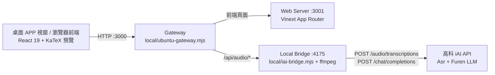
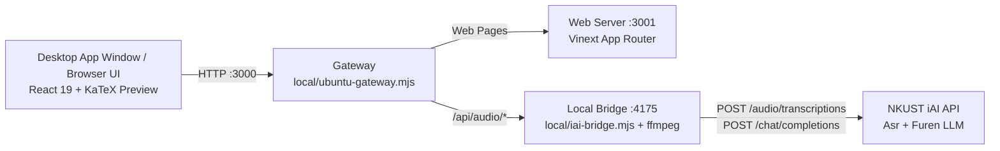

# NKUST iAI Note Tools｜知音筆記（高科 iAI 課堂錄音轉學習講義工具）

**Language / 語言**：[繁體中文](#繁體中文說明) | [English](#english-documentation)

---

<a id="繁體中文說明"></a>

## 🌱 專案初衷（Purpose & Vision）

> **「在老師課堂允許錄音的前提下，幫助學生把課堂錄音串接學校提供的 AI 模型，整理成一份真正屬於自己、結構清晰且便於複習的學習重點。」**

在大學專業課程（例如嵌入式系統、電子學、工程數學、演算法與各跨學科領域）中，課堂資訊量龐大，學生往往很難在「專心聽講理解」與「逐字抄寫筆記」之間兼顧。**國立高雄科技大學（NKUST）iAI 平台**已為全校師生提供了優秀的語音辨識（`Asr`）與大型語言模型（`Furen` 系列），本專案便是為此打造的開源輔助工具：

- **尊重教學規範**：請務必在授課教師明確允許錄音的前提下使用，並僅供個人課後學習與複習用途。
- **善用校內資源**：直接串接學生本人的高科 iAI API Key，無須額外付費購買外部商業轉錄服務。
- **隱私優先、零個資留存**：所有音訊切段與檔案處理皆在使用者本機端完成；API Key 僅暫存於執行期記憶體，絕不寫入資料庫、Cookie 或復原檔。
- **MIT 完全開源**：歡迎全校同學、老師與開發者自由下載、部署、學習與二次開發。

---

## ✨ 完整功能介紹

1. **大檔音訊自動分段轉碼（突破上傳與逾時限制）**
   - 支援 `MP3` / `M4A` / `WAV`，單檔最高 **30 MB**。
   - 內建 `ffmpeg-static` 自動將長錄音轉碼為單聲道 16 kHz / 32 kbps MP3（每 3 分鐘一段）再逐段送往 iAI `Asr`，避免觸發上游 `413 Request Entity Too Large` 或反向代理逾時。
2. **ASR 退化迴圈與邊界重疊清洗**
   - 自動偵測並移除語音辨識常見的連續跳針重複字詞與切段交界處的重複句子。
3. **繁體中文逐字稿校正（保留英文專有名詞）**
   - 透過 `Furen` 系列模型與 `opencc-js` 統一校正同音錯字、標點與斷句，同時完整保留英文技術術語、數學公式與程式碼縮排。
4. **多階段 AI 學習講義管線（篩選 → 撰寫 → 獨立校核 → 合併）**
   - **階段 A（內容篩選）**：自動區分 `study`（學習知識／考試作業提醒）、`aside`（閒聊）與 `noise`（雜訊）。
   - **階段 B（講義撰寫）**：產出教科書等級 Markdown 結構——包含「本次學習概覽」、依知識脈絡分章（`##` / `###`）、Markdown 比較表格、精確 LaTeX 數學公式推導、分步例題與附語言標籤的程式碼區塊。
   - **階段 C（獨立校核與本地容錯）**：驗證逐字稿單位覆蓋率、內建**數值四則運算驗算**、**KaTeX 公式可渲染性檢查**，並具備**零 Token 本地 JSON 語法修復**（自動修復漏冒號、中文引號、尾端空白註解等模型常見語法瑕疵）。
   - **階段 D（智慧合併與全篇複習）**：本地整合所有分段，自動去重並於文末產生唯一一份「全篇複習整理」（`必會觀念｜複習提示` 總表＋連續編號 `自我檢查` 思考題）。
5. **2 路受控並發與斷點續跑（不浪費 API 額度）**
   - 支援 2 段受控並發加速長錄音整理；若遇單段複雜內容，系統會自動二分切分為小單位重試。
   - 支援瀏覽器本地暫存與 **「下載復原檔（不含 API Key）」**，若中途網路中斷或額度用盡，可匯入復原檔從斷點直接續跑，已完成段落不重花任何 Token。
6. **跨平台原生桌面版 APP（Windows / macOS / Linux）**
   - 封裝為 Electron 桌面應用程式，點擊即自動於背景啟動內建 `Bridge`、`Web Server` 與 `Gateway`，免開終端機、免安裝 Node.js 與 FFmpeg。
   - **首次啟動捷徑精靈**：安裝後首次啟動會主動彈窗詢問「是否要在桌面建立捷徑？」——選 **「是」** 自動建立於使用者桌面；選 **「否」** 則自動建立於使用者安裝資料夾中。

---

## 🏗️ 系統架構與運作原理



| 核心模組 | 職責說明 |
| --- | --- |
| `electron/main.mjs` | Electron 桌面主程序：整合三層本機服務、動態埠位分配、跨平台 `ffmpeg` 路徑解析與首次啟動捷徑精靈 |
| `local/iai-bridge.mjs` | 本機音訊切段轉碼、iAI API 代理、NDJSON 進度串流、心跳保活與並發去重快取 |
| `local/ubuntu-gateway.mjs` | 統一入口反向代理、同源檢查、CSP 安全標頭與請求大小保護 |
| `lib/iai-workflow.ts` | 檔案驗證、ASR 退化清洗、分段切分、Thinking/規則雜訊過濾、KaTeX 驗證與 Markdown 匯出 |
| `lib/generic-content.ts` | 語意單位切分、篩選／回執解析、本地 JSON 語法預修復（漏冒號／尾端雜訊）與數值算式驗算 |
| `lib/generic-study.ts` | 多階段學習筆記主流程、2 路受控並發池、自動二分切分、容錯預算控制與斷點續跑 |
| `lib/generic-reader.ts` | 本地智慧合併章節、統整唯一「本次學習概覽」與「全篇複習整理」 |

---

## 📜 版本更新紀錄與版本控制（Changelog & Versioning）

本專案採用 **語意化版本控制（Semantic Versioning，`vMAJOR.MINOR.PATCH`）**，所有正式版均透過 Git Tag（`v*`）觸發 GitHub Actions 自動執行 109 項測試並同步建置 Windows、macOS、Linux 三大平台安裝包發布至 [GitHub Releases](https://github.com/WangBens/NKUST_iAI_Note-tools/releases)。

| 版本號 | 發布日期 | 更新重點與控制項目 |
| --- | --- | --- |
| **`v1.0.1`** | 2026-11-21 | • **首次啟動捷徑精靈**：安裝後首次啟動彈窗詢問是否於桌面建立捷徑（選「是」建於桌面、選「否」建於安裝資料夾），支援 Win `.lnk` / macOS `.app` / Linux `.desktop`。<br>• **跨平台全自動化發布**：GitHub Actions 同步編譯並公開發布 Windows（NSIS 安裝版＋免安裝 Zip）、macOS（arm64 / x64 DMG＋Zip）、Linux（AppImage＋deb）。<br>• **JSON 容錯大升級**：新增本地語法修復，自動修補模型漏寫冒號（如 `"body"> ...`）、誤用中文引號與尾端空白註解物件，0 Token 救援失敗回覆並放寬二分切分重試配額。<br>• **雙語文件**：新增完整中英文 README 與版本控制說明。 |
| **`v1.0.0`** | 2026-11-21 | • **桌面版 APP 正式封裝**：整合 Electron + ASAR 封裝與內建 `ffmpeg-static` 解包，實現免終端機、免裝 Node.js 一鍵啟動桌面圖形介面。<br>• **開源化與隱私清理**：移除所有環境特定路徑與內部設定，加入 MIT License 與完整開源指南。 |
| **`v0.9.x`** | 2026-11-19 | • **多階段校核與 2 路並發管線**：導入「篩選 → 撰寫 → 獨立校核 → 本地合併」架構，支援斷點續跑復原檔（不含 API Key）、LaTeX KaTeX 嚴格驗算與數值運算一致性檢查。 |
| **`v0.5.x`** | 2026-09-25 | • **三層服務架構與防逾時保活**：建立 `Gateway + Web + Bridge` 架構，加入 NDJSON 串流進度、心跳保活（避免 Cloudflare 524）與並發請求去重。 |

---

## 💻 下載與安裝教學

### 方式一：直接下載跨平台桌面版 APP（推薦一般使用者）

前往 [**GitHub Releases**](https://github.com/WangBens/NKUST_iAI_Note-tools/releases) 下載對應系統的最新安裝包：

- **Windows（64-bit）**：
  - `NKUST iAI Note Tools Setup x.x.x.exe`（標準安裝程式）或 `NKUST iAI Note Tools-x.x.x-win.zip`（免安裝綠色版）
- **macOS（Apple Silicon `arm64` / Intel `x64`）**：
  - `NKUST iAI Note Tools-x.x.x-arm64.dmg` / `x64.dmg`（拖曳至「應用程式」資料夾即可）
- **Linux（Ubuntu / Debian / 通用）**：
  - `NKUST iAI Note Tools-x.x.x.AppImage`（賦予執行權限 `chmod +x` 即可直接啟動）或 `.deb` 套件

> **💡 首次開啟提示**：安裝並首次啟動 APP 時，系統會跳出視窗詢問 **「是否要在桌面建立捷徑？」**，選 **「是」** 會新增至桌面，選 **「否」** 則會新增至您安裝程式的資料夾中。

### 方式二：開發者本機執行與自行打包

需求環境：**Node.js `>= 22.13.0`**、`pnpm`（透過 `corepack enable` 啟用）

```bash
# 1. 下載專案並安裝套件
git clone https://github.com/WangBens/NKUST_iAI_Note-tools.git
cd NKUST_iAI_Note-tools
corepack enable
pnpm install

# 2. 啟動桌面版 APP（自動建置並開啟原生視窗）
pnpm run electron:dev

# 3. 或以網頁開發模式啟動（需開兩個終端機）
pnpm run bridge   # 終端機 1：音訊與 LLM 橋接器 (:4175)
pnpm run dev      # 終端機 2：前端 Web 介面 (:3000)

# 4. 執行 109 項自動化測試（使用離線模擬伺服器，不消耗 iAI 額度）
pnpm run test
```

### 方式三：手機與平板（iOS / Android）操作方式

網頁介面已支援響應式排版（RWD）。可於電腦或 Ubuntu 伺服器啟動服務（搭配區網、Tailscale 或 Cloudflare Tunnel），在手機瀏覽器開啟網址後點擊 **「加入主畫面」** 即可如 App 般全螢幕操作。

---

<a id="english-documentation"></a>

# NKUST iAI Note Tools (English Documentation)

**Language**：[繁體中文](#繁體中文說明) | [English](#english-documentation)

---

## 🌱 Project Purpose & Vision

> **"With the instructor's permission to record lectures, this project empowers students to connect their classroom audio recordings to the university's AI models and generate well-structured, personalized study notes."**

University courses—especially technical subjects like Embedded Systems, Electronics, Engineering Mathematics, and Computer Science—pack dense concepts into every lecture. **National Kaohsiung University of Science and Technology (NKUST)** provides an institutional **iAI Platform** offering speech recognition (`Asr`) and Large Language Models (`Furen` series). **NKUST iAI Note Tools** bridges classroom recordings and the campus iAI API in an open-source, privacy-first way:

- **Academic Integrity First**: Always obtain explicit permission from your instructor before recording any lecture, and use generated notes strictly for personal study and review.
- **Campus-Native AI Integration**: Connects directly using your own NKUST iAI API Key—no paid third-party transcription subscriptions required.
- **Privacy by Design (Zero Data Retention)**: Audio splitting and transcoding run 100% locally on your machine. Your API Key stays in volatile runtime memory only and is never written to databases, cookies, or recovery files.
- **Fully Open Source (MIT License)**: Free to download, self-host, audit, and extend.

---

## ✨ Key Features

1. **Automatic Large-Audio Segmentation (`ffmpeg-static` Built-in)**
   - Accepts `MP3`, `M4A`, and `WAV` files up to **30 MB**.
   - Automatically transcodes audio locally into mono 16 kHz / 32 kbps MP3 segments (3 minutes each) before sending to `Asr`, eliminating `413 Payload Too Large` errors and reverse-proxy timeouts.
2. **ASR Degeneration & Boundary Overlap Cleanup**
   - Automatically detects and removes repetitive ASR hallucination loops and overlapping sentences across segment boundaries.
3. **Traditional Chinese Transcript Correction**
   - Fixes homophones, punctuation, and sentence boundaries using `Furen` models and `opencc-js`, while preserving English technical terms, mathematical notation, and code indentation.
4. **Multi-Stage AI Study Handout Pipeline (Filter → Draft → Independent Review → Merge)**
   - **Stage A (Content Filter)**: Classifies units into `study` (academic concepts & exam/assignment reminders), `aside` (chitchat), and `noise`.
   - **Stage B (Handout Writer)**: Produces textbook-grade Markdown with a Learning Overview, logical chapters (`##` / `###`), comparison tables, KaTeX/LaTeX formulas, step-by-step worked examples, and syntax-highlighted code blocks.
   - **Stage C (Independent Review & Local Repair)**: Verifies unit-by-unit coverage, checks explicit numeric arithmetic, validates KaTeX renderability, and applies **zero-token local JSON syntax repair** (automatically fixing missing colons, Chinese quotation marks, and phantom trailing commentary blocks).
   - **Stage D (Smart Local Merge)**: Deduplicates chapters and compiles a single unified End-of-Document Review table (`Key Concepts | Review Tips`) plus sequentially numbered self-check questions.
5. **Controlled 2-Way Concurrency & Checkpoint Resume (Zero Wasted Tokens)**
   - Processes up to 2 chunks concurrently and automatically bisects complex chunks on retry.
   - Supports browser local checkpoints and **Key-Free Recovery JSON Export** so interrupted jobs (network drop or quota limit) resume right where they stopped without re-billing completed segments.
6. **Cross-Platform Native Desktop App (Windows / macOS / Linux)**
   - Packaged with **Electron**—automatically boots the embedded `Bridge`, `Web Server`, and `Gateway` in the background with no terminal commands, Node.js, or FFmpeg installation required.
   - **First-Launch Shortcut Prompt**: Upon first launch after installation, a dialog asks whether to create a Desktop shortcut. Choosing **"Yes"** places the shortcut on your Desktop; choosing **"No"** places it inside the application's installation folder (`.lnk` on Windows, `.app` symlink on macOS, `.desktop` launcher on Linux).

---

## 🏗️ System Architecture



| Core Module | Responsibility |
| --- | --- |
| `electron/main.mjs` | Electron main process: boots all three local services, resolves bundled `ffmpeg`, and runs the cross-platform first-launch shortcut prompt |
| `local/iai-bridge.mjs` | Local FFmpeg segmentation, iAI API proxy, NDJSON progress streaming, heartbeat keep-alive, and credential-isolated request deduplication |
| `local/ubuntu-gateway.mjs` | Unified reverse proxy, same-origin enforcement, CSP headers, and payload size guards |
| `lib/iai-workflow.ts` | File validation, ASR loop cleanup, chunking, thinking/meta-rule stripping, KaTeX verification, and Markdown export |
| `lib/generic-content.ts` | Semantic unit splitting, filter/receipt parsing, local malformed JSON repair, and numeric arithmetic verification |
| `lib/generic-study.ts` | Multi-stage pipeline orchestrator, 2-way concurrency pool, automatic bisection, retry budget control, and checkpoint resume |
| `lib/generic-reader.ts` | Local chapter merger, overview deduplication, and unified end-of-document review builder |

---

## 📜 Changelog & Version Control

This project follows **Semantic Versioning (`vMAJOR.MINOR.PATCH`)**. Pushing a version tag (`v*`) triggers the automated GitHub Actions pipeline (`.github/workflows/release-desktop.yml`), which runs all **109 automated tests**, builds native installers for **Windows, macOS, and Linux**, and publishes them to [GitHub Releases](https://github.com/WangBens/NKUST_iAI_Note-tools/releases).

| Version | Release Date | Highlights & Controls |
| --- | --- | --- |
| **`v1.0.1`** | 2026-11-21 | • **First-Launch Shortcut Prompt**: Prompts users on first launch to create a shortcut on the Desktop (`Yes`) or in the installation folder (`No`) across Windows, macOS, and Linux.<br>• **Full Cross-Platform Releases**: Automated CI builds and publishes Windows (NSIS Setup + Portable Zip), macOS (Apple Silicon & Intel DMG + Zip), and Linux (AppImage + `.deb`).<br>• **Enhanced Local JSON Repair**: Fixes missing colons (`"body"> ...`), misquoted fields, Chinese closing quotes, and trailing phantom commentary objects locally at zero token cost; expands retry allowance for bisected chunks.<br>• **Bilingual Documentation**: Added full English + Traditional Chinese README and version changelog. |
| **`v1.0.0`** | 2026-11-21 | • **Desktop App Packaging**: Integrated Electron with ASAR packaging and unpacked `ffmpeg-static` for zero-setup native GUI launch.<br>• **Open-Source Release**: Audited for zero PII/secrets, added MIT License and deployment guides. |
| **`v0.9.x`** | 2026-11-19 | • **Multi-Stage Verified Pipeline**: Added Filter → Write → Independent Review workflow, 2-way concurrency, key-free recovery checkpoints, and strict KaTeX/arithmetic validation. |
| **`v0.5.x`** | 2026-09-25 | • **Three-Tier Local Architecture**: Built `Gateway + Web + Bridge` with NDJSON streaming, Cloudflare 524 heartbeat keep-alive, and concurrent request deduplication. |

---

## 💻 Download & Installation

### Option 1: Download Pre-Built Desktop App (Recommended)

Visit [**GitHub Releases**](https://github.com/WangBens/NKUST_iAI_Note-tools/releases) and download the package for your OS:

- **Windows (x64)**: `NKUST iAI Note Tools Setup x.x.x.exe` (Installer) or `.zip` (Portable)
- **macOS (Apple Silicon `arm64` / Intel `x64`)**: `.dmg` or `.zip`
- **Linux (x64)**: `.AppImage` (Portable) or `.deb` (Debian / Ubuntu)

### Option 2: Run from Source (Developers)

Requirements: **Node.js `>= 22.13.0`**, `pnpm` (via `corepack enable`)

```bash
git clone https://github.com/WangBens/NKUST_iAI_Note-tools.git
cd NKUST_iAI_Note-tools
corepack enable
pnpm install

# Launch native Electron Desktop App
pnpm run electron:dev

# Run all 109 automated tests (offline mock server, zero API cost)
pnpm run test
```

### Offline Mock Mode (No API Quota Used)

```bash
# Terminal 1: Start local mock iAI server (127.0.0.1:4174)
pnpm run mock

# Terminal 2: Start dev server
pnpm run dev
```

Open `http://localhost:3000/?testMode=1` and enter `test-valid-key` to test the full 6-step workflow offline.

---

## 📄 License

Released under the [MIT License](./LICENSE). Free for personal study, modification, and open-source distribution.
