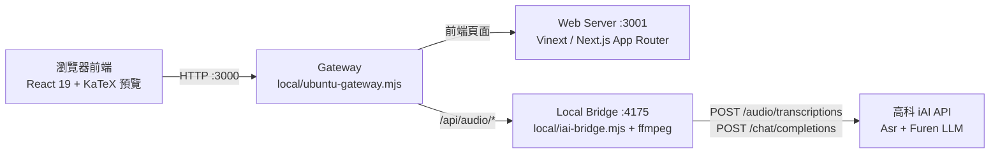
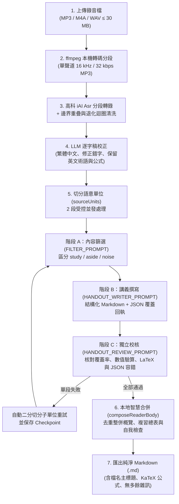

# NKUST iAI Note Tools｜高科 iAI 課堂錄音轉學習講義工具

一套專為 **國立高雄科技大學（NKUST）iAI 平台** 設計的開源 Web 工具。只要輸入自己的高科 iAI API Key 並上傳課堂錄音檔（支援 MP3 / M4A / WAV，單檔最高 30 MB），系統就會自動完成 **本機音訊分段轉錄 → 繁體中文逐字稿校正 → 多階段 AI 講義撰寫與校核 → Markdown 匯出**，產出結構清晰、含 LaTeX 公式、比較表格、分步例題與章末複習的繁體中文學習筆記。

> 本專案採用 **MIT License** 完全開源，歡迎自由下載、本機執行、部署與二次開發。

---

## 核心特色

- **大檔自動切段，突破 API 上傳限制**：自動透過內建 `ffmpeg-static` 將長錄音轉為單聲道 16 kHz / 32 kbps MP3 小段再送往 `Asr`，避免觸發上游 `413 Request Entity Too Large` 或反向代理逾時。
- **ASR 退化迴圈清洗**：自動偵測並移除語音辨識常見的連續跳針重複與分段邊界重疊。
- **教科書等級 Markdown 講義架構**：
  - 開頭提供「本次學習概覽」（學習範圍與閱讀方式導覽）；
  - 正文依知識脈絡分章（`##`／`###`）並以 `---` 分隔，交替運用條列重點、Markdown 比較表格、精確 LaTeX 公式推導、分步計算例題與程式碼區塊；
  - 結尾自動整合唯一一份「全篇複習整理」（`必會觀念｜複習提示` 總表＋`自我檢查` 編號思考題）。
- **多階段校核與斷點續跑（不浪費 Token）**：
  - 每段皆經過「內容篩選 → 講義撰寫 → 獨立校核」，並搭配本地數值驗算、LaTeX 可渲染性檢查與 JSON 容錯修補；
  - 支援 **2 段受控並發** 加速長錄音整理；
  - 支援瀏覽器本地暫存與「下載復原檔（不含 API Key）」，中途網路中斷或額度不足時可從斷點續跑，已完成段落不重花額度。
- **零伺服器個資留存**：API Key 僅存於瀏覽器記憶體並以 HTTP Header 傳送，不寫入資料庫、Cookie 或復原檔；暫存音訊於處理結束或取消後自動刪除。

---

## 系統架構與運作原理

### 1. 三層本地服務架構



- **Web 應用（`app/page.tsx`）**：提供 6 步驟引導介面、Markdown + LaTeX 即時預覽、復原檔匯入／匯出與核心筆記管線調度。
- **Local Bridge（`local/iai-bridge.mjs`，預設 `127.0.0.1:4175`）**：
  - 負責接收錄音、呼叫 `ffmpeg` 切段轉碼、逐段送往 iAI `Asr` 並以 NDJSON 串流回報即時進度；
  - 代理轉發 LLM 請求並定時送出心跳（Heartbeat），防止長耗時推論遭反向代理（如 Cloudflare 524）中斷；
  - 內建並發去重機制，避免重複送出相同請求造成多餘計費。
- **Gateway（`local/ubuntu-gateway.mjs`，正式部署用，預設 `:3000`）**：統一將前端頁面導向 `:3001`、將 `/api/audio/*` 導向 `:4175`，方便單一對外入口部署。

### 2. 完整 AI 處理管線（Pipeline）



#### 各核心模組說明

| 檔案路徑 | 職責說明 |
| --- | --- |
| `lib/iai-workflow.ts` | 檔案驗證、ASR 退化清理、分段切分、Thinking 標籤與規則雜訊清洗、LaTeX 驗證與 Markdown 匯出（`buildMarkdown`） |
| `lib/learning-instruction.ts` | 講義撰寫與校核共用的系統提示詞（`LEARNING_NOTES_INSTRUCTION`）與內部 JSON 傳輸規約 |
| `lib/generic-content.ts` | 語意單位切分、篩選／回執解析、JSON 尾端退化本地修復、內容合規驗證與明確數值算式驗算（`assertNumericArithmetic`） |
| `lib/generic-study.ts` | 完整多階段學習筆記主流程、2 路受控並發池、自動二分切分與 Checkpoint 斷點續跑管理 |
| `lib/generic-reader.ts` | 本地合併多段章節、自動去重整併「本次學習概覽」與「全篇複習整理」表格與連續編號自我檢查題 |
| `lib/study-text.ts` | 使用 `opencc-js` 將內文統一轉為繁體中文，同時完整保留英文術語、LaTeX 與程式碼區塊 |
| `local/iai-bridge.mjs` | 本機音訊分段轉碼、iAI API 代理、NDJSON 進度串流與請求去重 |

---

## 環境需求

- **Node.js**：`>= 22.13.0`（建議 Node.js 22 LTS 或 24+）
- **套件管理器**：`pnpm`（建議透過 Node 內建的 `corepack enable` 自動啟用 `pnpm@11.19.0`）
- **FFmpeg**：專案已透過 `ffmpeg-static` 內建，通常無需額外安裝
- **API Key**：高科 iAI 平台（`https://www.iai.nkust.edu.tw`）核發之有效 API Key

---

## 安裝與本機啟動教學

### 步驟 1：下載專案並安裝相依套件

```bash
git clone https://github.com/WangBens/NKUST_iAI_Note-tools.git
cd NKUST_iAI_Note-tools
corepack enable
pnpm install
```

### 步驟 2：啟動本機服務（開發／個人使用）

請開啟**兩個終端機視窗**（PowerShell、Terminal 皆可）：

- **終端機 1：啟動音訊與 LLM 橋接器（Port 4175）**
  ```bash
  pnpm run bridge
  ```
- **終端機 2：啟動前端 Web 介面（Port 3000）**
  ```bash
  pnpm run dev
  ```

啟動完成後，打開瀏覽器前往 `http://localhost:3000` 即可使用。

---

## 使用步驟說明

開啟網頁後，依照畫面上的 6 步驟引導操作即可：

1. **步驟 1｜驗證 API Key**：貼上您的高科 iAI API Key 並點擊驗證（金鑰僅暫存於瀏覽器記憶體，關閉頁面即清除）。
2. **步驟 2｜上傳課堂錄音**：拖曳或選擇 MP3、M4A 或 WAV 錄音檔（單檔上限 30 MB）。
3. **步驟 3｜選擇輸出模式與模型**：
   - 可選擇「僅輸出繁體中文逐字稿」或「逐字稿校正＋完整學習講義」；
   - 選擇欲使用的 Furen 系列模型（預設 `Furen-std`，複雜理工課程可視需求切換更高階模型）。
4. **步驟 4｜自訂額外要求（選填）**：可補充個人閱讀偏好（例如「加強考點整理」、「多舉實務例子」），亦可開啟瀏覽器本地自動暫存進度。
5. **步驟 5｜即時處理與斷點續跑**：
   - 畫面會即時顯示上傳、轉碼、分段轉錄、逐字稿校正與重點整理狀態；
   - 若中途因網路不穩、逾時或額度不足暫停，可點選 **「下載復原檔（不含 API Key）」** 保存進度，或直接按 **「續跑未完成重點」** 接著補齊，已完成段落不會重跑。
6. **步驟 6｜預覽與匯出**：
   - 直接於網頁檢視渲染後的 Markdown 與 LaTeX 數學公式；
   - 一鍵複製、下載 `<檔名>-重點整理.md` 或另存純逐字稿 `.md`。

---

## Linux / Ubuntu 正式環境部署（選用）

專案根目錄已附帶三份通用 `systemd` 服務範例檔：

- `study-notes-bridge.service`（音訊／LLM 橋接服務，Port `4175`）
- `study-notes-web.service`（`vinext start` 正式版前端，Port `3001`）
- `study-notes-gateway.service`（統一入口反向代理，Port `3000`）

部署步驟：

```bash
# 1. 建置正式版
pnpm install
pnpm run build

# 2. 複製並依實際部署路徑修改三份 .service 檔的 WorkingDirectory 與環境變數
mkdir -p ~/.config/systemd/user
cp study-notes-*.service ~/.config/systemd/user/
# 編輯 ~/.config/systemd/user/study-notes-*.service，確認路徑與 IAI_ALLOWED_ORIGINS

# 3. 啟用並啟動服務
systemctl --user daemon-reload
systemctl --user enable --now study-notes-bridge.service study-notes-web.service study-notes-gateway.service
```

若要對外公開，建議搭配 **Cloudflare Tunnel（`cloudflared`）** 將網域指向 `http://127.0.0.1:3000`，並在 `study-notes-bridge.service` 的 `IAI_ALLOWED_ORIGINS` 中加入您的正式網域。

---

## 測試與開發指令

本專案包含 **108 項自動化單元與整合測試**，涵蓋音訊切段、重複清洗、JSON／LaTeX 修復、斷點續跑、憑證遮蔽與跨學科管線驗證：

```bash
# 執行全部 108 項自動化測試（使用隔離的本地模擬伺服器，不消耗真實 API 額度）
pnpm run test

# 程式碼靜態檢查（oxlint）
pnpm run lint

# 正式環境建置
pnpm run build
```

### 離線模擬測試模式（不消耗 iAI 額度）

若想在不花費真實 API 額度的情況下測試前端操作流程：

```bash
# 終端機 1：啟動本地模擬 iAI 伺服器（127.0.0.1:4174）
pnpm run mock

# 終端機 2：啟動開發伺服器
pnpm run dev
```

接著開啟 `http://localhost:3000/?testMode=1`，輸入測試用 Key `test-valid-key` 即可完整體驗流程。

---

## 常見問題排解（FAQ）

- **Q：驗證 API Key 出現 401 或 `budget_exceeded`？**  
  A：請確認高科 iAI 後台的 API Key 是否有效且尚有可用額度；若額度用完，重設額度後可直接點選「續跑未完成重點」接著完成，不需重新轉錄。
- **Q：為什麼需要同時啟動 `bridge` 與 `dev`？**  
  A：瀏覽器無法直接執行 `ffmpeg` 切段，且直接從前端連線長耗時 LLM 容易受限於瀏覽器／代理逾時，因此透過本機 `bridge` 負責音訊轉碼、分段送出與心跳保活。
- **Q：API Key 會被上傳或存進復原檔嗎？**  
  A：不會。復原檔匯出與錯誤訊息皆經過白名單與金鑰遮蔽處理，完全不含 API Key，可安心保存或分享除錯。

---

## 授權條款

本專案以 [MIT License](./LICENSE) 開源釋出，任何人皆可自由使用、修改與散佈。
